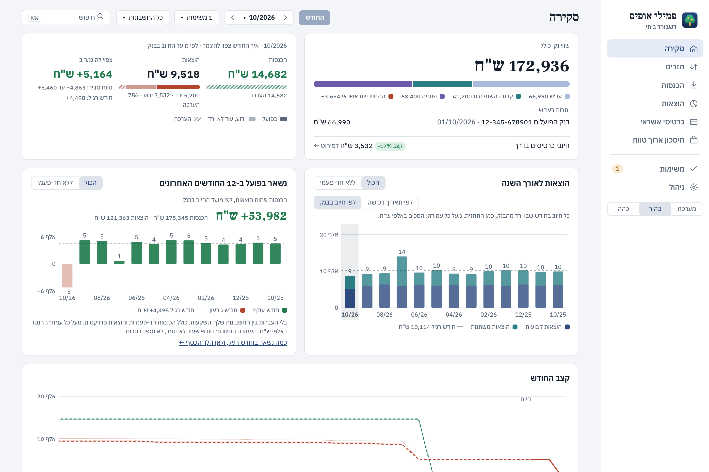
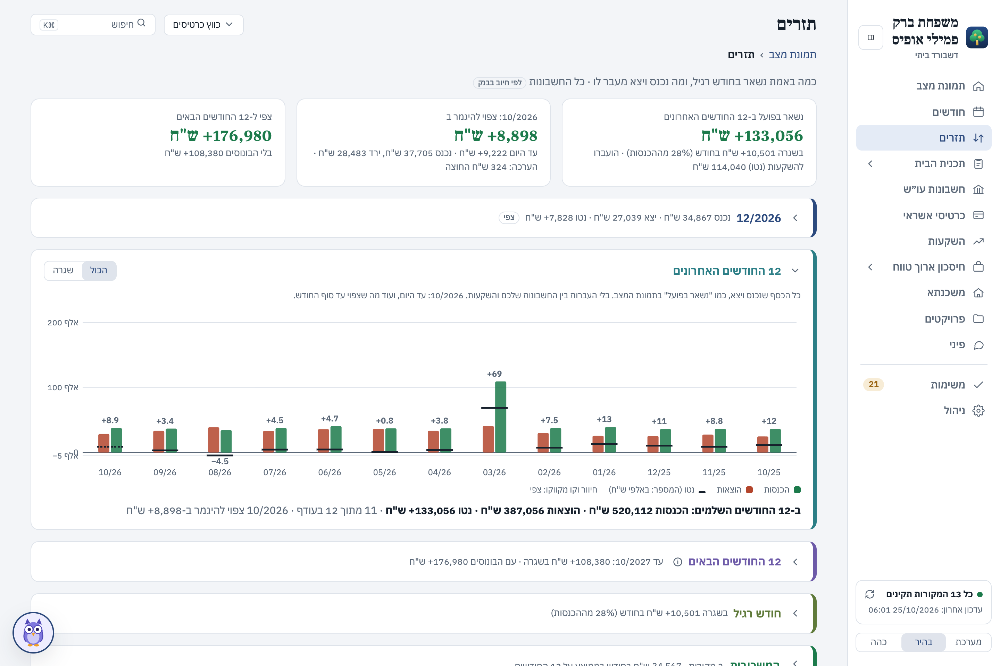
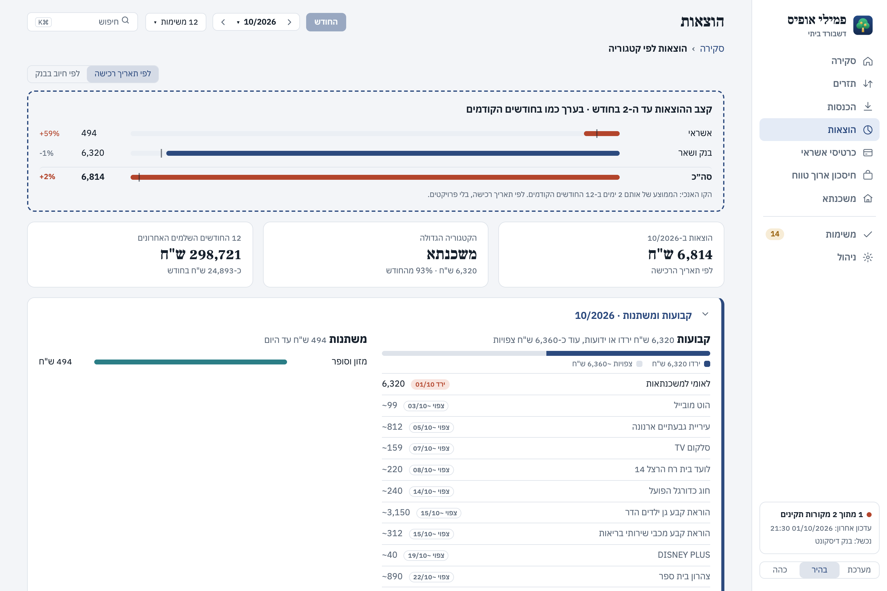
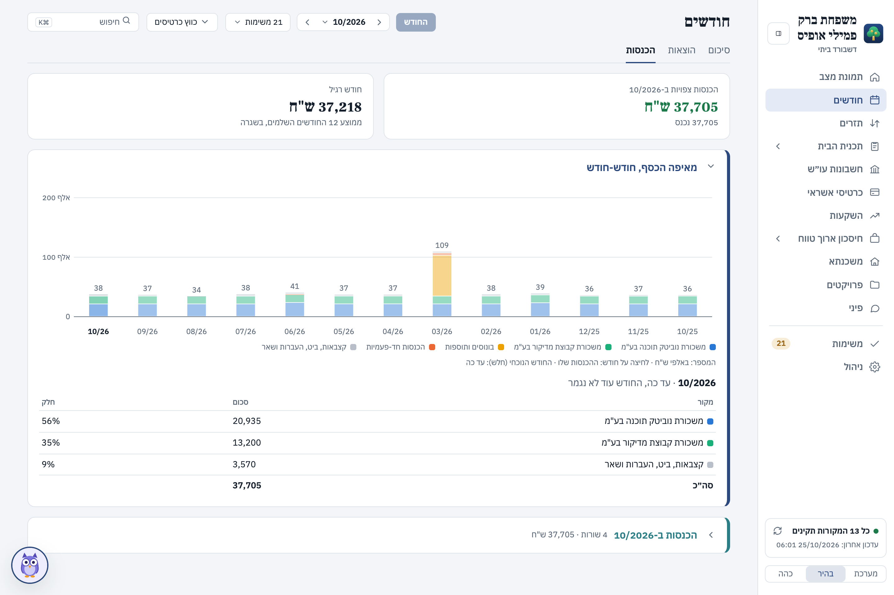
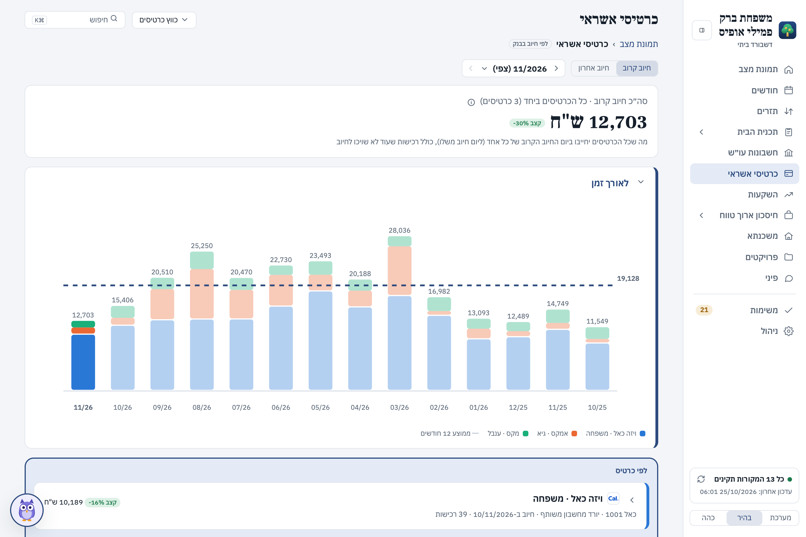
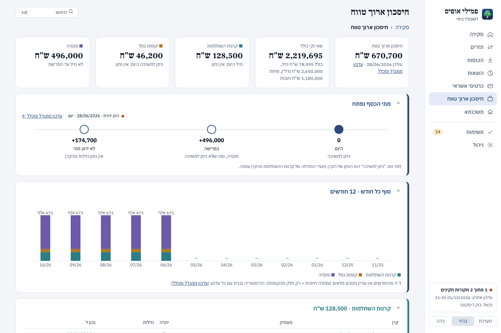

# My Family Office

אפליקציה למק ולווינדוס שמרכזת את החשבונות וכרטיסי האשראי של המשפחה במקום אחד: כמה נכנס, כמה יצא, כמה נשאר בכל חודש, ולאן הכסף הולך. הכול נשמר אצלך במחשב.

## צילומי מסך

הצילומים מנתוני דמו של כמה משקי בית בדויים (משפחה, רווק, חופשת לידה), לא מנתונים אמיתיים.

**סקירה:** כמה נכנס, כמה יצא וכמה נשאר החודש, שווי נקי, ומה נשאר בפועל בכל אחד מ-12 החודשים האחרונים.

**תזרים:** מה כבר ירד מהבנק ומה עוד צפוי לרדת עד סוף החודש, ותחזית ל-12 החודשים הבאים.

**הוצאות:** קבועות ומשתנות, לפי קטגוריה, ובהשוואה לחודשים קודמים.

**הכנסות:** מאיפה הכסף מגיע, חודש אחרי חודש, כולל הכנסות חד-פעמיות.

**כרטיסי אשראי:** החיוב הקרוב בכל כרטיס, לאורך זמן ומול חודש רגיל.

**חיסכון ארוך טווח:** פנסיה, קרנות השתלמות וקופות גמל, ומתי הכסף נפתח למשיכה.

## התקנה

יש גרסה למק וגרסה לווינדוס. בוחרים את המחשב שלכם:

- [התקנה במק](#התקנה-במק) – מק עם שבב Apple (M1 ואילך)
- [התקנה בווינדוס](#התקנה-בווינדוס) – Windows 10 או 11, ‏64 ביט

### התקנה במק

1. **הורדה:** בעמוד [הגרסה האחרונה](../../releases/latest), תחת Assets, מורידים את הקובץ שנגמר ב-`arm64.dmg` (למשל `My.Family.Office-0.1.7-arm64.dmg`).
2. **העתקה:** פותחים את הקובץ שהורד וגוררים את **My Family Office** לתיקיית **Applications**.
3. **פתיחה ראשונה:** האפליקציה לא חתומה אצל Apple, ולכן בפעם הראשונה macOS חוסם אותה:
   - פותחים את האפליקציה מתיקיית Applications. תופיע הודעה שאי אפשר לאמת את המפתח. לוחצים "סיום" (Done).
   - פותחים **הגדרות המערכת › פרטיות ואבטחה**, גוללים למטה, וליד ההודעה על My Family Office לוחצים **"פתח בכל זאת"** (Open Anyway).
   - מאשרים עם הסיסמה של המחשב או עם Touch ID, ובחלון שנפתח לוחצים שוב "פתח".

   מכאן והלאה האפליקציה נפתחת רגיל.
4. **מדריך ההתחלה:** בפתיחה הראשונה נפתח מדריך: שם המשפחה, הוספת חשבונות בנק וכרטיסי אשראי, וטעינה ראשונה של שנה אחורה. הטעינה הראשונה לוקחת כמה דקות.

### התקנה בווינדוס

1. **הורדה:** בעמוד [הגרסה האחרונה](../../releases/latest), תחת Assets, מורידים את הקובץ שנגמר ב-`setup-x64.exe` (למשל `My.Family.Office-0.1.7-setup-x64.exe`).
2. **התקנה:** פותחים את הקובץ שהורד. האפליקציה לא חתומה, ולכן Windows מציג מסך כחול "Windows protected your PC" (בעברית: "Windows הגן על המחשב שלך"):
   - לוחצים **More info** (מידע נוסף).
   - לוחצים **Run anyway** (הפעל בכל זאת).

   ההתקנה רצה לבד, בלי שאלות ובלי הרשאות מנהל, והאפליקציה נפתחת בסופה. נוסף קיצור דרך בשולחן העבודה ובתפריט התחל.
3. **מדריך ההתחלה:** בפתיחה הראשונה נפתח מדריך: שם המשפחה, הוספת חשבונות בנק וכרטיסי אשראי, וטעינה ראשונה של שנה אחורה. הטעינה הראשונה לוקחת כמה דקות.
4. **סמל ליד השעון:** האפליקציה מוסיפה סמל באזור ההתראות שליד השעון. משם אפשר לפתוח אותה שוב או לצאת ממנה.

## מה נשמר ואיפה

| | מק | ווינדוס |
|---|---|---|
| **הנתונים** | `~/Library/Application Support/My Family Office/` | `%APPDATA%\My Family Office\` |
| **שמות משתמש וסיסמאות לבנקים** | ב-Keychain של המק, תחת השם `family-office` | בתיקיית הנתונים, מוצפנים בהצפנה של Windows: רק המשתמש הזה, במחשב הזה, יכול לפתוח אותם |

- הכול נשמר במחשב שלך בלבד. הסיסמאות לא מוצגות שוב באפליקציה ולא יוצאות מהמחשב, חוץ מאשר לאתר של הבנק עצמו בזמן הטעינה.
- **פתיחה עם הכניסה למחשב:** האפליקציה נפתחת ברקע וטוענת נתונים פעם ביום, מ-07:30. אפשר לכבות את זה במסך **ניהול**. מקורות שדורשים קוד חד-פעמי (למשל מגדל וכלל) לא נטענים אוטומטית לעולם.

## מה האפליקציה שולחת החוצה

- **לאתרי הבנקים וחברות האשראי** שהוספת: כניסה עם הפרטים שלך, כדי לקרוא תנועות ויתרות. זה כל מה שהבנק רואה.
- **ל-GitHub, כמה פעמים ביום:** בדיקה אם יש גרסה חדשה, והורדה שלה כשיש. הבקשות לא כוללות שום נתון שלך.
- **לשרת הצפייה מהטלפון (office.schorfamily.com), רק אם תפעיל אותה:** עותק מוצפן של המסכים, שרק טלפון שחיברת יכול לפתוח. השרת לא יכול לקרוא אותו. בלי הפעלה לא נשלח כלום.
- **ל-Anthropic (Claude), רק אם תבחר:** אם תזין מפתח API במסך "סיווג אוטומטי", נשלחים שמות בתי עסק מכרטיסי האשראי כדי לסווג אותם. לא נשלחים סכומים, תאריכים או פרטי חשבון. בלי מפתח לא נשלח כלום.

אין פרסומות ואין סטטיסטיקות שימוש. יש שרת רק לצפייה מהטלפון, לבחירתך, והוא מחזיק רק נתונים מוצפנים.

## עדכון לגרסה חדשה

- **רוב העדכונים נכנסים מתוך האפליקציה, במק ובווינדוס כאחד.**
  - האפליקציה בודקת כמה פעמים ביום אם יש גרסה חדשה, ומורידה אותה ברקע (בדרך כלל כ-25MB).
  - כשהעדכון מוכן, מופיע בתפריט הצד **"עדכון מוכן – הפעלה מחדש"**. לחיצה מפעילה מחדש את האפליקציה עם הגרסה החדשה. בלי לחיצה, העדכון נכנס בפעם הבאה שהאפליקציה נפתחת.
  - הנתונים והסיסמאות לא משתנים.
- **כל עדכון חתום דיגיטלית.** האפליקציה מתקינה רק עדכון שנחתם במפתח של המפרסם, ובודקת שהקובץ שירד הוא בדיוק הקובץ שנחתם. עדכון שלא עולה כמו שצריך מבוטל אוטומטית, והאפליקציה חוזרת לגרסה הקודמת.
- **לפעמים צריך קובץ התקנה חדש.** זה קורה כשמתעדכנים הרכיבים הבסיסיים (Electron או Chrome). אז מופיע "גרסה חדשה זמינה – הורדה", שמוביל לעמוד הגרסה:
  - **במק:** מורידים את ה-`dmg` החדש וגוררים את האפליקציה לתיקיית Applications, כדי להחליף את הקיימת.
  - **בווינדוס:** מורידים את ה-`setup-x64.exe` החדש ומריצים אותו. הוא מתקין מעל הגרסה הקיימת.

  בשני המקרים הנתונים והסיסמאות נשארים.
- **בדיקה ידנית:** במסך **ניהול** יש כפתור "בדיקת עדכונים עכשיו".

## הסרה

### במק

1. מוחקים את **My Family Office** מתיקיית Applications.
2. כדי למחוק גם את הנתונים: ב-Finder בוחרים **מעבר › מעבר לתיקייה**, מקלידים `~/Library/Application Support/My Family Office` ומוחקים את התיקייה.
3. כדי למחוק גם את הסיסמאות: פותחים את **Keychain Access** (גישה למחזיק המפתחות), מחפשים `family-office`, ומוחקים את הפריטים.

### בווינדוס

1. סוגרים את האפליקציה: לחיצה ימנית על הסמל שליד השעון › **יציאה**.
2. פותחים **הגדרות › אפליקציות › אפליקציות מותקנות**, מוצאים את **My Family Office** ובוחרים **הסר התקנה**.
3. ההסרה משאירה את הנתונים והסיסמאות. כדי למחוק גם אותם: לוחצים Win+R, מקלידים `%APPDATA%` ולוחצים Enter, ומוחקים את התיקייה **My Family Office**. הסיסמאות שמורות באותה תיקייה, ונמחקות איתה.

## חשוב לדעת

- **מקור הנתונים:** הטעינה עובדת דרך אתרי הבנקים עצמם, כמו כניסה רגילה. כשבנק משנה את האתר שלו, הטעינה ממנו עלולה להיכשל עד לגרסה הבאה. שאר המקורות ממשיכים לעבוד.
- **בדיקה לפני החלטות:** זה פרויקט ביתי, לא מוצר של בנק או של יועץ פיננסי. כדאי לבדוק מספרים חשובים מול הבנק לפני שמחליטים על סמכם.

